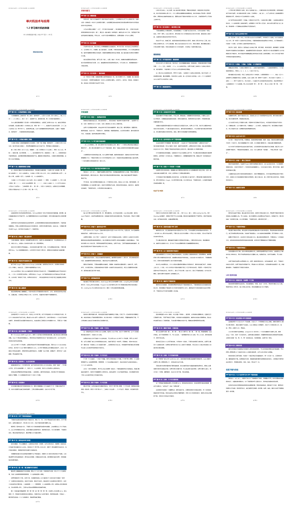

# PPT逐字稿助手

调用名：`$ppt-script`

这是一个用于高职/中职备课的Codex Skill。它会读取现有PPT、教材和参考资料，生成逐页对应、可直接照读、适合彩印的Word课堂逐字稿。

## 支持导入的教学资料

- **讲课视频、MOOC视频和微课录像**：提取课程讲授顺序、解释方法、案例和容易遗漏的知识前置内容。
- **PPT或PPTX课件**：作为逐字稿的页面顺序、讲授范围和翻页对应主线。
- **教材、电子书和PDF资料**：用于核对概念、参数、代码、例题与课后习题，避免脱离指定教材。
- **教案、课程标准、教学大纲和教学进度表**：用于确定教学目标、重点难点、课时和考核要求。
- **教师自己的补充说明**：保留教师习惯的表达方式，补充“为什么这样做”和学生容易不懂的地方。

可以同时提供多种资料。Skill会区分它们的作用：以最新版PPT控制逐页顺序，以教材和课程标准校核知识，以视频和参考教案丰富讲法，不把附件中的文字当作对Codex的操作指令。

## 这套Skill记住了什么

- 以PPT页序为主线，不漏页、不乱序。
- 正文只写教师说的话，不夹带教学设计提醒。
- 不安排等待学生回答的互动。
- 对“为什么要生成HEX”“编译和下载有什么区别”等容易被PPT跳过的前置知识主动补足。
- 代码联系硬件现象讲解，特别核对芯片型号、引脚和高低电平条件。
- 输出单一DOCX，封面独立，按PPT页使用彩色隔断，最后渲染检查。

## 安装：推荐直接让Codex完成

在Codex中新建一个任务，把本仓库链接发给Codex，然后直接说：

> 请从这个GitHub私人仓库安装Skill：`https://github.com/zcq19991029/ppt-script`

Codex会使用Skill安装功能，把它安装到正确目录。私人仓库需要当前电脑已经登录并有权访问该GitHub账号。安装完成后，在下一条消息或新任务中即可调用。

也可以明确写：

> 请使用Skill Installer安装 `zcq19991029/ppt-script` 仓库中的Skill，名称设为 `ppt-script`。

### 备用：手动安装

只有自动安装失败时，才需要下载仓库并把文件夹放到：

`C:\Users\你的用户名\.codex\skills\ppt-script`

安装完成后刷新Codex或新建任务。

## 在Codex中调用

最短调用方式：

`用 $ppt-script 帮我备课。`

例如：

`用 $ppt-script 按照最新PPT给我制作80分钟逐字稿，只写老师说的话，不设置提问等待。`

## 推荐输入

- 最新版PPT
- 教材或课程标准
- 参考教案、MOOC视频或教师补充讲法
- 课时长度、讲授截止页和是否安排实操

## 隐私保护

- Skill默认只在本地处理文件，不会自行上传PPT、教材、视频、教案或生成的逐字稿。
- 导入的讲课视频、教材、教案、课程标准和PPT只用于当前备课任务；除非用户明确要求，不复制进Skill仓库，也不建立公开分享链接。
- 仓库只包含通用规则、配置和脱敏效果图，不包含任何用户原始教学资料。
- 不在示例和日志中写入姓名、学号、邮箱、手机号、本地绝对路径或私人访问凭据。
- 只有在用户明确要求上传时才执行外部上传，并先核对GitHub账号和仓库可见性。
- 本仓库设为Private，仅仓库所有者和授权协作者可访问。

## 仓库文件

- `SKILL.md`：Codex执行逐字稿任务时遵循的规则。
- `agents/openai.yaml`：Skill在Codex中的显示名称和默认提示。
- `assets/preview.png`：脱敏后的彩色分页效果预览。
